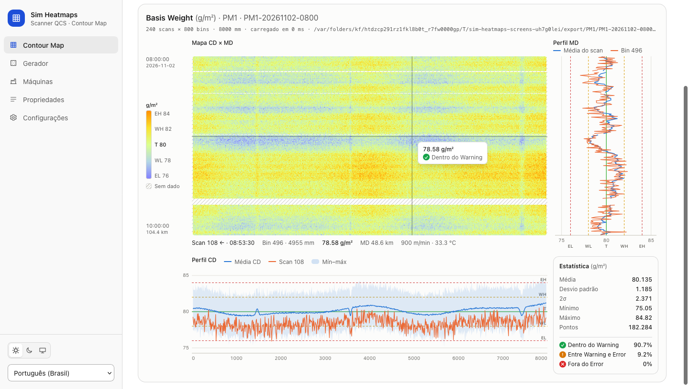
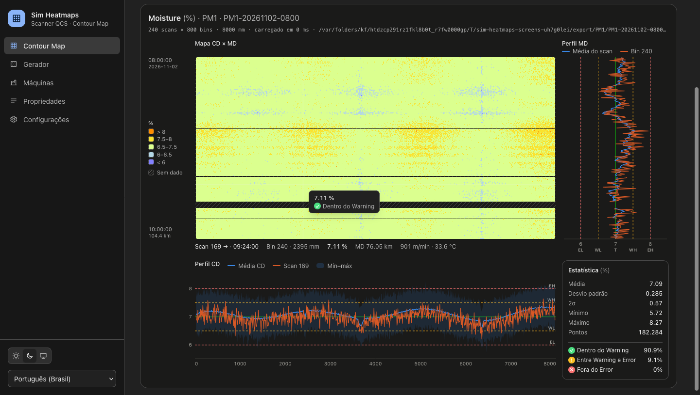
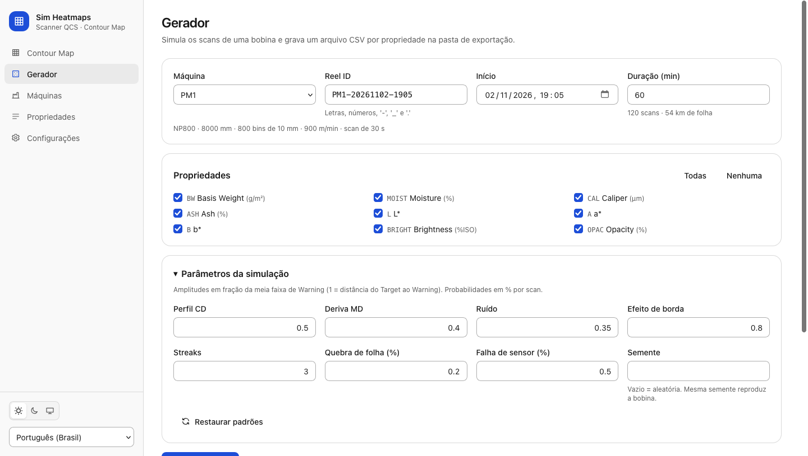
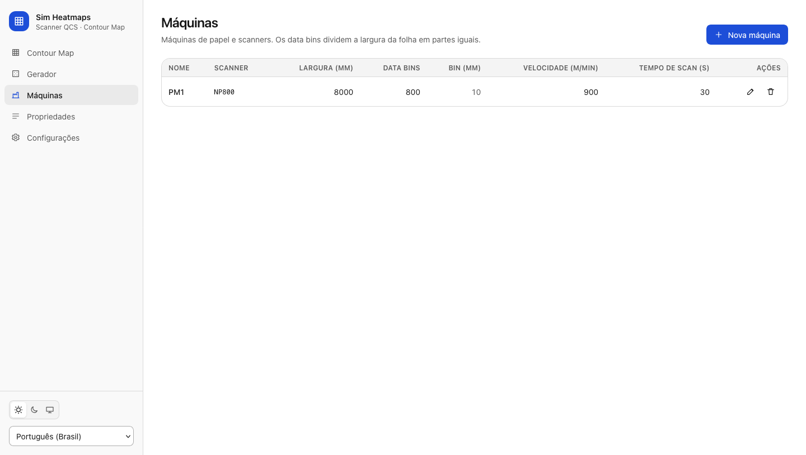
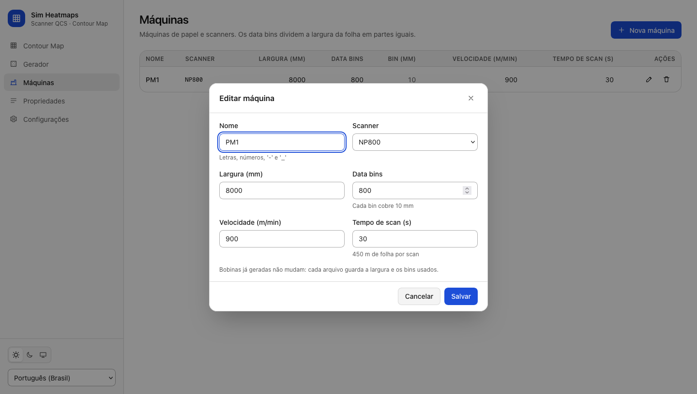
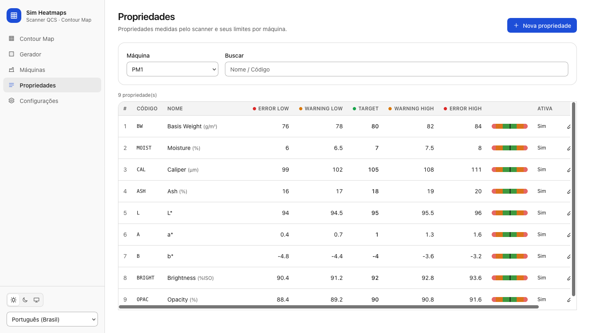
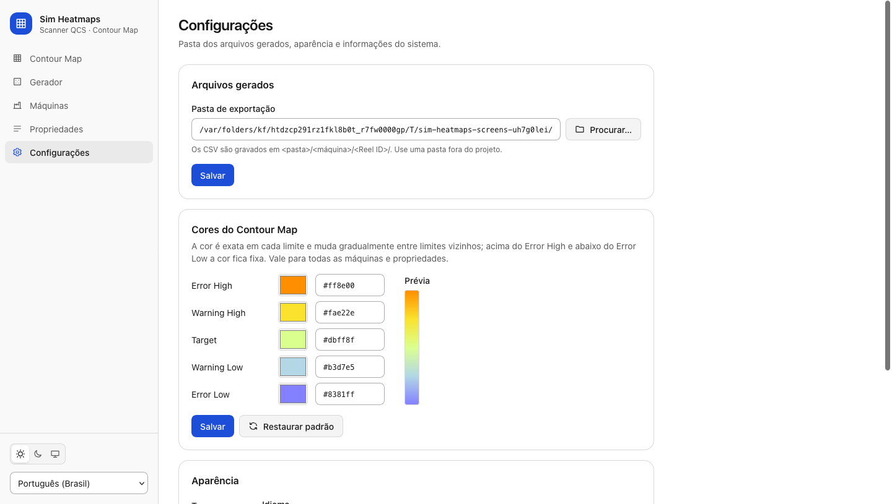

# Sim Heatmaps

Simulador multiplataforma (Linux, macOS, Windows) que gera arquivos `.csv` dos dados vindo do scanner. 

## Requisitos

Tauri 2 + Rust + SQLite (rusqlite) + React/Tailwind.

## Executar

```bash
npm install
npm run tauri dev        # desenvolvimento
npm run tauri build      # instalador para a plataforma atual
```

Pré-requisitos: Rust estável, Node 20+ e as [dependências do Tauri](https://tauri.app/start/prerequisites/)
para o sistema operacional.

## Compilação e distribuição

| Sistema | Comando | Instaladores |
|---------|---------|--------------|
| Linux | `scripts/build.sh` | `.deb`, `.rpm`, `.AppImage` |
| macOS | `scripts/build.sh` (`--universal` para Intel + Apple Silicon) | `.dmg`, `.app.zip` |
| Windows | `scripts\build.cmd` ou `.\scripts\build.ps1` | `.msi`, `-setup.exe` (NSIS) |

Etapas: pré-requisitos → `npm ci` → testes → `tauri build` → cópia para
`release/<versão>/<sistema>-<arquitetura>/` com `SHA256SUMS.txt`.

Opções comuns (`build.sh` / `build.ps1`):

| build.sh | build.ps1 | Efeito |
|----------|-----------|--------|
| `--dry-run` | `-DryRun` | mostra os comandos sem executar |
| `--bundles rpm,deb` | `-Bundles msi` | escolhe os formatos |
| `--target TRIPLE` | `-Target TRIPLE` | alvo Rust (ex.: `aarch64-apple-darwin`) |
| `--skip-tests` / `--skip-install` | `-SkipTests` / `-SkipInstall` | pula etapas |
| `--clean` | `-Clean` | limpa builds anteriores |
| `--debug` | `-DebugBuild` | build sem otimizações |

Cada sistema gera apenas os próprios instaladores; para os três, rode o script em cada um (ou em CI).

## Fluxo

1. **Máquinas** – MB6 e MB8 são criadas na primeira execução a partir dos arquivos de referência.
   Outros `.csv` podem ser importados pelo botão *Importar .csv*.
2. **Propriedades** – CRUD com código, nome, casas decimais, grade de posições CD e limites
   `SpecLow < WarningLow < Target < WarningHigh < SpecHigh` (verde / amarelo / vermelho).
3. **Amostra** – escolha a máquina, digite o Sample ID, *Gerar valores* (sorteio ~N(Target, σ) com
   ±2σ = faixa de Warning), edite as células e *Exportar .al3*.
4. **Configurações** – pasta de exportação, prefixo do caminho do cabeçalho, tema e idioma.

## Arquitetura

```
src-tauri/crates/domain          entidades, regras, traits de repositório (sem I/O)
src-tauri/crates/application     casos de uso, DTOs, erros i18n, logs
src-tauri/crates/infrastructure  SQLite (migrações), repositórios, leitor/escritor .al3
src-tauri/src                    commands Tauri + composition root
ui/                              React + Tailwind (tokens claro/escuro, pt-BR/en-US)
tmp/                             scripts Python (stdlib, --dry-run)
```

Banco: `<app data>/sim-heatmaps.db` (Linux: `~/.local/share/com.simautoline.desktop/`).
Logs: `./log` em desenvolvimento, `<app data>/log` em produção. Esses caminhos não são configuráveis;
apenas a pasta de exportação é (padrão `~/Documentos/sim-heatmaps/export`).

## Verificação

```bash
cd src-tauri && cargo test --workspace
cargo run -p infrastructure --example export_demo -- ../tmp/out
python3 tmp/validate_al3.py --strict-stats tmp/out/*.al3
```

## Telas

As imagens ficam em `assets/screenshots/` e podem ser regeneradas com
`python3 tmp/capture_screens.py`. O script fotografa a interface real no Firefox headless; as
respostas do backend são simuladas com dados gerados pelo próprio backend Rust (máquina PM1 e
duas bobinas).

### Contour Map



Tela principal. Escolha a máquina, a bobina (Reel ID) e a propriedade, ou abra um CSV gerado
com **Abrir arquivo**. O mapa CD × MD mostra a largura da máquina no eixo X e os scans no eixo Y.
Na escala **Degradê pelos limites**, a cor é exata em cada limite (Error Low, Warning Low,
Target, Warning High, Error High) e muda gradualmente entre limites vizinhos. Acima do Error High
e abaixo do Error Low, a cor fica fixa. Scans sem dado (quebra de folha, falha de sensor ou fora
das bordas) aparecem hachurados.
Ao passar o mouse, o mapa mostra o valor e o status da célula. O **Perfil MD**, à direita, traz a
média de cada scan e o bin sob o cursor. O **Perfil CD**, abaixo, traz a média CD, o scan sob o
cursor e a faixa mín–máx. Os dois perfis exibem as linhas de limite. O painel **Estatística**
mostra média, desvio padrão, 2σ, mínimo, máximo e a porcentagem de pontos em cada faixa.



A mesma tela no tema escuro com a escala **Faixas**: as mesmas cinco cores, uma por faixa, sem
transição. As cores são configuradas em **Configurações**.

### Gerador



Simula os scans de uma bobina e grava um CSV por propriedade na pasta de exportação. Informe a
máquina, o Reel ID, o início e a duração (convertida em scans pelo tempo de scan da máquina) e
escolha as propriedades. Em **Parâmetros da simulação** é possível ajustar o perfil CD, a deriva MD,
o ruído, o efeito de borda, os streaks e as probabilidades de quebra de folha e de falha de sensor.
A mesma **semente** reproduz a mesma bobina.

### Máquinas



Máquinas de papel com modelo do scanner (NP800, NP1200, RNP1200), largura, data bins, velocidade
e tempo de scan. Os data bins dividem a largura da folha em partes iguais.



Formulário de inclusão e edição. O padrão é 800 data bins, e o formulário mostra a largura de cada
bin e quantos metros de folha passam por scan. Bobinas já geradas não mudam, porque cada arquivo
guarda a largura e os bins usados.

### Propriedades



Propriedades medidas pelo scanner (Basis Weight, Moisture, Caliper, Ash, L\*, a\*, b\*, Brightness,
Opacity…), por máquina, com busca por nome ou código. Cada linha mostra os cinco limites
(Error Low, Warning Low, Target, Warning High, Error High) e uma barra com as faixas. A ordem
`Error Low < Warning Low < Target < Warning High < Error High` é validada ao salvar.

### Configurações



Pasta de exportação dos CSV e **Cores do Contour Map**: uma cor por limite, com seletor, código
`#rrggbb`, prévia do degradê e **Restaurar padrão**. As cores valem para todas as máquinas e
propriedades. A tela também traz tema (claro, escuro ou sistema), idioma (pt-BR ou en-US), versão
e o local do banco de dados e dos logs.
